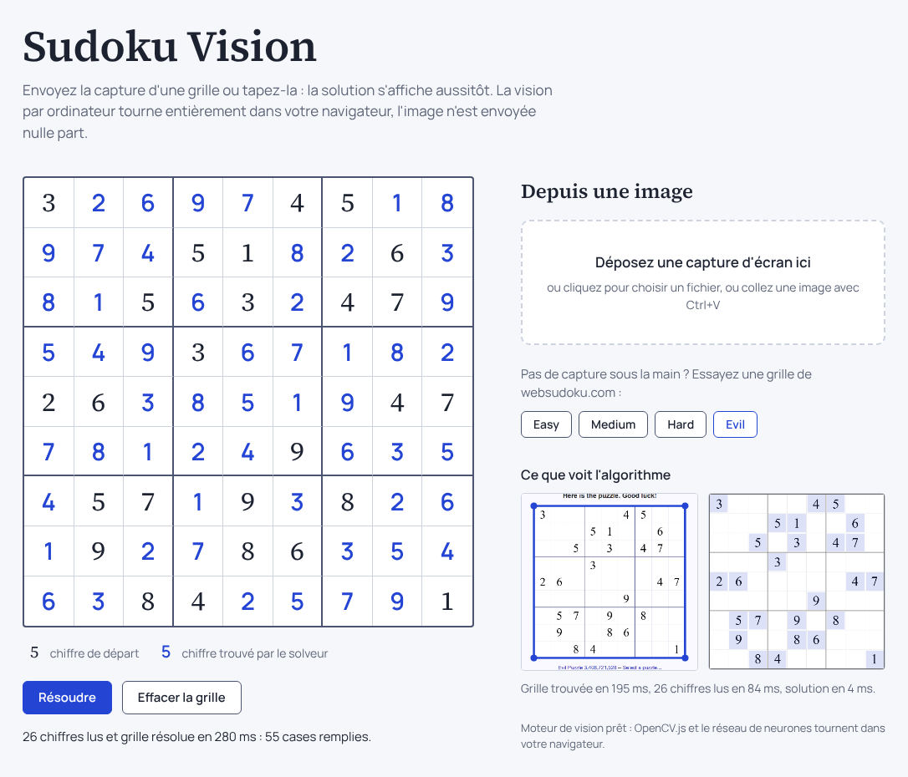
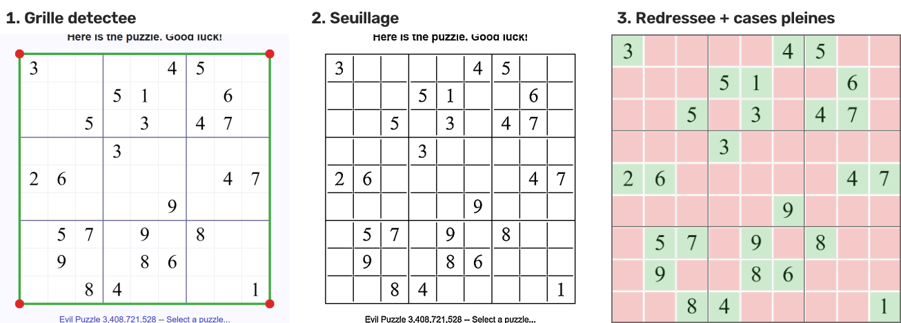
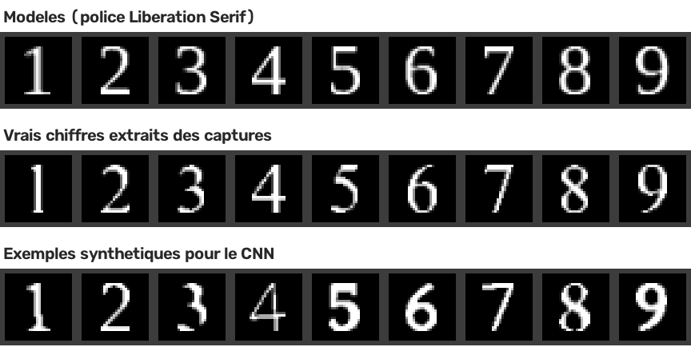

# Sudoku Vision

[](https://github.com/mael292005/computer_vision_sudoku/actions/workflows/ci.yml)


**Un bot de computer vision qui regarde l'écran, lit une grille de Sudoku sur [websudoku.com](https://www.websudoku.com/), la résout et la remplit tout seul.**

**[Essayer en ligne](https://mael292005.github.io/computer_vision_sudoku/)** : envoyez une capture de grille ou tapez-la, la solution s'affiche aussitôt. Tout tourne dans le navigateur.

<!-- Démo : enregistrer une partie avec `sudoku-vision play` et placer le GIF ici :

-->

[](https://mael292005.github.io/computer_vision_sudoku/)

## Résultats

Mesurés sur 4 captures d'écran complètes (niveaux Easy, Medium, Hard et Evil) avec `sudoku-vision benchmark`. Aucune de ces captures n'a servi à construire les modèles.

| Étape | Résultat |
| --- | --- |
| Détection de la grille | 4 / 4 grilles |
| Cases vides ou pleines | 324 / 324 cases |
| Lecture des chiffres (CNN et template matching) | 115 / 115 chiffres |
| Grilles résolues de bout en bout | 4 / 4 |
| Temps total, de l'image à la solution | environ 40 ms |

**Robustesse.** Les deux méthodes de lecture font 100 % sur les captures d'origine. Pour les départager, on dégrade les captures : on les réduit (comme un navigateur moins zoomé) et on les floute (`sudoku-vision benchmark --scale 0.25 --blur 1`).

| Conditions | Template matching | CNN |
| --- | --- | --- |
| Capture d'origine (grille de 776 px) | 115 / 115 | 115 / 115 |
| Réduite à 50 % + flou de 1,5 px | 115 / 115 | 115 / 115 |
| Réduite à 35 % + flou de 1 px | 113 / 115 | **115 / 115** |
| Réduite à 35 % + flou de 1,5 px | 94 / 115 | **115 / 115** |
| Réduite à 25 % + flou de 1 px (grille de 194 px) | 91 / 115 | **115 / 115** |
| Réduite à 25 % + flou de 1,5 px | 57 / 115 | 76 / 115 |

Le CNN, entraîné sur des chiffres variés, résiste bien mieux aux images dégradées : c'est le classifieur utilisé par défaut. Le template matching reste une bonne référence, simple et sans entraînement.

## Fonctionnement

Le bot est une chaîne de six étapes, chacune dans son propre module :

```
 Capture d'écran ──▶ Détection grille ──▶ Découpe des cases
  capture.py           grid.py              cells.py
                                                │
                                                ▼
 Saisie auto     ◀── Solveur          ◀── Lecture des chiffres
  actuator.py         solver.py             digits.py
```

| Étape | Rôle | Techniques principales |
| --- | --- | --- |
| 1. Capture | Capture l'écran et gère la mise à l'échelle (écrans HiDPI) | `mss` |
| 2. Détection de la grille | Trouve la grille et la redresse en un carré vu de face | Seuillage adaptatif, contours, transformation de perspective (OpenCV) |
| 3. Découpe des cases | Découpe la grille en 81 cases et repère les cases vides | Proportion de pixels « encre » |
| 4. Lecture des chiffres | Reconnaît le chiffre de chaque case pleine | Template matching ou CNN (PyTorch → ONNX → OpenCV) |
| 5. Solveur | Résout la grille 9×9 | Backtracking + heuristique MRV, masques de bits |
| 6. Saisie automatique | Clique sur chaque case vide et tape la réponse | `pyautogui`, perspective inverse pour viser le centre des cases |

Les étapes 2 à 4 sont la vraie computer vision : elles transforment des pixels bruts en une grille 9×9 d'entiers que le solveur sait traiter.

### Étapes 2 et 3 : trouver la grille et les cases pleines



1. **Détection** : après le seuillage, on garde le plus grand contour à 4 coins presque carré. Le logo « WEB SUDOKU », plus petit, est écarté.
2. **Seuillage adaptatif** : chaque pixel est comparé à la moyenne de son voisinage, ce qui isole les traits et les chiffres quel que soit l'éclairage.
3. **Redressement et découpe** : la grille est projetée en un carré de 450 px, puis découpée en 81 cases. Une case est pleine (en vert) si plus de 1 % de ses pixels sont de l'encre. Mesuré sur le jeu de test : 0 % pour une case vide, au moins 3,7 % pour un chiffre (le « 1 », le plus fin).

### Étape 4 : lire les chiffres, deux approches comparées

Chaque chiffre est d'abord isolé et normalisé au **format MNIST** : 28×28 pixels, blanc sur noir, centré dans une boîte de 20×20. Le seuil qui sépare l'encre du fond est calculé pour chaque case, à mi-chemin entre son pixel le plus sombre et le plus clair : un chiffre flou ou grisé reste lisible.



- **Template matching** : on compare le chiffre à un modèle de chaque chiffre de 1 à 9, rendu avec la police Liberation Serif (équivalente à Times, la police du site). On garde le modèle avec la meilleure corrélation normalisée. Pas d'entraînement, mais l'approche dépend de la police.
- **CNN** : un petit réseau convolutif (2 couches de convolution, environ 55 000 paramètres) entraîné avec PyTorch sur des chiffres **synthétiques** : 12 polices différentes, avec des variations aléatoires de taille, position, rotation, épaisseur, flou et bruit. Il est exporté au format **ONNX** et exécuté par le module `cv2.dnn` d'OpenCV : **PyTorch n'est pas nécessaire pour utiliser le bot**, seulement pour réentraîner le modèle.

Aucun des deux n'a vu les captures de websudoku.com pendant sa construction : les résultats en haut de page sont une évaluation honnête, pas un score sur les données d'entraînement.

### Étapes 5 et 6 : résoudre et remplir

Le solveur remplit d'abord la case qui a le moins de candidats possibles (heuristique MRV). Les candidats sont stockés dans des masques de bits, ce qui rend le calcul très rapide. Il détecte aussi les grilles invalides : si un chiffre est mal lu, la grille contient souvent un doublon, et le bot s'arrête au lieu de remplir n'importe quoi.

Pour cliquer au bon endroit, la position de chaque case à l'écran est calculée avec la transformation de perspective inverse. Le rapport entre pixels de capture et pixels souris est mesuré, pour gérer les écrans mis à l'échelle (Windows à 125 % ou 150 %, Mac Retina).

## Le site web

[https://mael292005.github.io/computer_vision_sudoku/](https://mael292005.github.io/computer_vision_sudoku/)

Le site reprend tout le pipeline, mais dans le navigateur : la détection de la grille passe par **OpenCV.js** et la lecture des chiffres par le **même CNN** (le fichier ONNX), exécuté par **ONNX Runtime Web**. Il n'y a aucun serveur : l'image ne quitte jamais l'ordinateur de l'utilisateur, et le site est hébergé gratuitement sur GitHub Pages.

On peut déposer une capture, la coller avec Ctrl+V, choisir un des exemples, ou taper la grille à la main. Les chiffres en conflit sont surlignés, et les chiffres lus avec peu de certitude sont soulignés pour être vérifiés.

**Une seule logique, deux langages.** Le code JavaScript (`web/js/`) est un portage direct du code Python, avec les mêmes réglages, jusqu'à l'arrondi des ,5 vers le pair comme en Python. Des tests (`web/tests/`) font passer les 4 captures du jeu de test dans le pipeline JavaScript et vérifient qu'il lit exactement les mêmes 115 chiffres. Ces tests tournent dans la CI et avant chaque mise en ligne.

```bash
cd web
npm install
npm test          # solveur + parité avec la version Python
npm run serve     # site en local sur http://localhost:8000
```

## Installation

```bash
git clone https://github.com/mael292005/computer_vision_sudoku.git
cd computer_vision_sudoku
python -m venv .venv && source .venv/bin/activate   # Windows : .venv\Scripts\activate
pip install -e ".[screen]"
```

| Option | Installe | Sert à |
| --- | --- | --- |
| *(aucune)* | OpenCV, NumPy, Typer | Lire et résoudre une grille depuis une image |
| `screen` | `mss`, `pyautogui` | Capture d'écran et saisie automatique |
| `ml` | `torch`, `onnx`, `pillow` | Réentraîner le CNN |
| `dev` | `pytest`, `ruff`, `mypy`… | Développement et tests |

## Utilisation

**Faire jouer le bot** sur websudoku.com :

```bash
sudoku-vision play
```

Ouvre une grille sur websudoku.com, lance la commande, puis affiche la fenêtre du navigateur : le bot capture l'écran au bout de 3 secondes, lit la grille, la résout et la remplit. Pour l'arrêter à tout moment, amène la souris dans un coin de l'écran. Options utiles : `--no-fill` (afficher la solution sans toucher à la souris), `--model template`, `--debug dossier/`.

**Résoudre une capture d'écran**, avec les images de chaque étape :

```bash
sudoku-vision solve --image tests/data/websudoku_evil.png --debug debug/
```

**Résoudre une grille en texte** (81 caractères, `0` ou `.` pour les cases vides) :

```bash
sudoku-vision solve --grid "8..........36......7..9.2...5...7.......457.....1...3...1....68..85...1..9....4.."
```

**Mesurer la précision** sur le jeu de test :

```bash
sudoku-vision benchmark
```

## Jeu de test

`tests/data/` contient 4 captures d'écran complètes de websudoku.com, une par niveau, et `grids.json` avec les chiffres attendus. Chaque grille annotée a exactement une solution, ce qui confirme que la recopie est juste. Les tests vérifient chaque étape du pipeline sur ces 4 captures.

## Réentraîner les modèles

```bash
pip install -e ".[ml,dev]"
python training/make_templates.py   # modèles du template matching
python training/train_cnn.py        # CNN, exporté dans src/sudoku_vision/assets/
python scripts/make_readme_figures.py
```

## Structure du projet

```
src/sudoku_vision/
├── capture.py      # capture d'écran, conversion des coordonnées
├── grid.py         # détection et redressement de la grille
├── cells.py        # découpe des 81 cases, vide ou pleine
├── digits.py       # extraction des chiffres, template matching, CNN
├── synthetic.py    # génération de chiffres synthétiques
├── solver.py       # solveur, sans dépendance à la vision
├── actuator.py     # clics et frappes clavier
├── pipeline.py     # enchaîne toutes les étapes, mode debug
├── evaluate.py     # métriques sur un jeu de test annoté
├── cli.py          # commandes sudoku-vision
└── assets/         # modèles livrés avec le package
training/           # construction des modèles
tests/              # tests unitaires et d'intégration, captures dans tests/data/
web/                # le site : solveur et vision en JavaScript, tests de parité
scripts/            # génération des figures du README
docs/images/        # figures du README
```

## Développement

```bash
pip install -e ".[dev]"
pre-commit install          # lint, formatage et typage à chaque commit
ruff check . && ruff format --check .
mypy                        # typage strict
pytest --cov
```

Chaque push relance ces vérifications dans GitHub Actions, sur Python 3.11 et 3.12.

## Limites et pistes d'amélioration

- **Un seul site** : les réglages (seuils, police des modèles) sont adaptés à websudoku.com. Le CNN, entraîné sur 12 polices, devrait mieux s'adapter à d'autres sites que le template matching.
- **Petit jeu de test** : 4 grilles et 115 chiffres. Un jeu plus large donnerait des métriques plus solides.
- **Grille visible en entier** : la grille doit être entièrement affichée à l'écran au moment de la capture.

**Prochaines étapes :** photo d'un Sudoku papier (perspective forte, éclairage variable), mode webcam en temps réel avec la solution affichée en réalité augmentée, chiffres manuscrits.

## Licence

[MIT](LICENSE)
